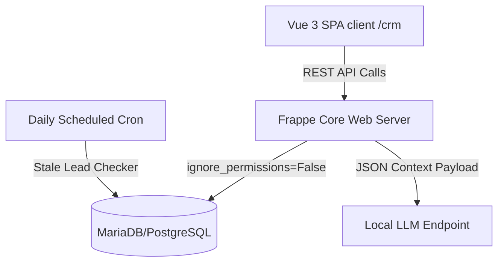

# Architecture Documentation: Standalone AI-Driven CRM

This document describes the design, system components, backend structure, and permission models of the modified **Standalone AI-Driven CRM SaaS Application**.

---

## 🗺️ Architectural Overview

The application is structured as a modern, decoupled Single Page Application (SPA) driven by a metadata-oriented Python server backend. The core tech stack consists of:
1. **Frontend**: Vue.js 3 SPA with `frappe-ui` UI kit, built using Vite.
2. **Backend**: Python server powered by the Frappe web framework, utilizing MariaDB/PostgreSQL for persistent relational storage.
3. **AI Services**: Local LLM inference server (LM Studio or OpenAI-compatible API endpoint) processing context-rich CRM documents dynamically.

---

## 🔒 Security & Permission Model

To guarantee production readiness, all analytical search endpoints respect the CRM's role-based access rules and sales hierarchy structures:

1. **Permission Hardening**:
   - Statistical aggregations and lead/deal queries in the AI Advisor backend run strictly through `frappe.get_list(ignore_permissions=False)`.
   - Sales reps can only search, count, or summarize leads/deals that they have explicit read access to under the Sales Hierarchy.
2. **Defensive Gates**:
   - Access to lead-scoring and action recommendation APIs is wrapped in `frappe.has_permission` checks.
   - If a sales agent requests access to records beyond their scope, the system returns a secure, friendly warning message instead of letting standard database tracebacks crash the UI.

---

## 🤖 AI Advisor & Insights Engine

The AI integration consists of an active conversation partner and a passive lead scoring layout:

### 1. Data Context Ingestion
When queries are sent to the AI engine, the backend retrieves:
* Lead/Deal attributes (Status, Industry, Expected Revenue, Conversion Probability).
* Timeline notes (parsed and stripped of HTML layout elements).
* Active task checklists and comments.

This data is dynamically formatted and injected into a structured system prompt, preventing LLM hallucinations and ensuring responses are grounded in factual CRM entries.

### 2. UI Components
* **AI Insights Card (`Lead.vue`)**: Embedded directly inside the Lead view, rendering a real-time summary card that updates automatically as sales teams modify notes or record attributes.
* **AI Advisor Panel (`AIAdvisorPanel.vue`)**: A slide-out chat drawer accessible globally via a floating action button. Uses custom-scoped Vanilla CSS classes (`.ai-floating-btn`, `.ai-avatar`) to render high-contrast purple-indigo gradient backgrounds, keeping custom sparkles icons fully visible.

---

## 🎨 White-Labeled SaaS Separation

To present a clean, standalone CRM SaaS product that is completely separated from the generic ERPNext/Frappe framework, the following isolation gates were implemented:

1. **Desk Redirection**: Custom route handlers intercept standard index redirects (`/`) and push users directly to the Vue SPA (`/crm`), keeping standard users locked inside the CRM portal.
2. **User Dropdown Isolation (`UserDropdown.vue`)**:
   - Excludes the standard "Desk" app switcher option for non-administrator accounts.
   - Hides the "About" modal option from non-admins.
   - Dynamically collapses the "Apps" menu entirely if no other sibling apps are installed on the tenant site.
   - Preserves access to "Settings" for standard managers.
3. **Settings Page Cleanup (`Settings.vue`)**:
   - Completely deleted the "ERPNext" integration setting panel.
   - Removed the "Home Actions" customization tab since the profile menu is static and pre-configured.
4. **Branded Login Portal (`login.html`)**:
   - Overrode base `navbar` and `footer` blocks to remove default branding links (e.g. "About Us", "Imprint", "Built on Frappe" credits).
   - Removed the "Login with Frappe Cloud" OAuth button.
   - Swapped fallback app titles from "Frappe" to "CRM" on all entry forms.

---

## ⏰ Cron Scheduler (`events.py`)
A daily cron job runs `daily_stale_leads_check` to flag inactive leads. The checker:
* Filters out `Converted` and `Lost` leads.
* Evaluates active leads that have not had comments, notes, or tasks updated in the configured threshold period.
* Appends stale warnings and notifies owners.
